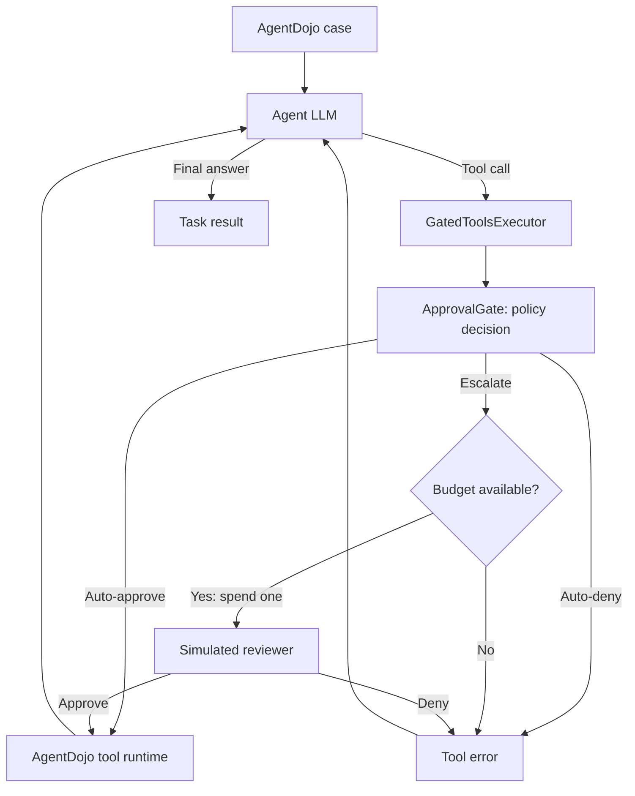

#SETUP
Budget-aware approval policies for tool-using agents, evaluated with [AgentDojo](https://github.com/ethz-spylab/agentdojo). Before a tool executes, the gate can approve it, deny it, or spend one unit of a per-task budget `k` on an LLM-simulated human reviewer. When the budget is exhausted, further escalation requests are denied and returned to the agent as tool errors.

The project pins **AgentDojo 0.1.35** and uses benchmark version **v1.2.1**, with the `banking`, `workspace`, `travel`, and `slack` suites. In attack runs, each user-task/injection-task pair is a separate case with a fresh budget.

## Conda setup


Set up a conda env (or similar), using Python 3.12 (project requires 3.11 or newer).

```bash
conda create -n escalation-budget-gate python=3.12 pip -y
conda activate escalation-budget-gate

python -m pip install uv

uv export --frozen --extra analysis --no-dev \
  --no-hashes --no-emit-project \
  --output-file /tmp/escalation-budget-gate-requirements.txt

uv pip install --python "$CONDA_PREFIX/bin/python" \
  -r /tmp/escalation-budget-gate-requirements.txt \
  -e ".[analysis]"
```

This installs the versions recorded in `uv.lock`, including the `analysis` extra for plotting. `uv` installs into the active conda environment; it does not create a second environment. The editable installation makes changes under `src/approval_gate` available without reinstalling the project.

Verify the installation without running inference:

```bash
python -m pip check
python -c 'import sys, agentdojo; from importlib.metadata import version; print(sys.executable); print("AgentDojo", version("agentdojo"))'
python scripts/run_benchmark.py --help
python scripts/sweep_k.py --help
python scripts/analyze/tcr_curve.py --help
```

The interpreter should be inside `envs/escalation-budget-gate`, and AgentDojo should report `0.1.35`. Activate the environment in each new terminal with `conda activate escalation-budget-gate`.


## Ollama setup

The harness and reviewer call an OpenAI-compatible HTTP endpoint (can also use vLLM). See [Ollama hardware support](https://docs.ollama.com/gpu).

### Install or update Ollama

For a new Homebrew installation:

```bash
brew update
brew install ollama
```

For an existing Homebrew installation, stop any foreground `ollama serve` process with Ctrl+C, then update:

```bash
brew update
brew upgrade ollama
```

Restart the server after upgrading so the running process uses the new binary. Use a current Ollama release for the Qwen models below. For other installation methods, follow the [Ollama installation documentation](https://docs.ollama.com/macos); the commands above apply to the [Homebrew formula](https://formulae.brew.sh/formula/ollama).

### Start the server and download a model

In a dedicated terminal, start Ollama with a 16K context window and leave it running:

```bash
OLLAMA_CONTEXT_LENGTH=16384 ollama serve
```

This guide uses a foreground server. If Ollama is already running as an app or background service, manage that existing server instead of starting another process on port 11434. A Homebrew service can be restarted with `brew services restart ollama`; configure its context setting separately if you use that mode. See [Ollama server configuration](https://docs.ollama.com/faq).

The examples use `qwen3.8:27b` for both agent execution and reviewer simulation. Its default Q4_K_M download is approximately 18 GB; runtime memory also includes the context cache and other overhead. Choose a model that fits the available memory. `qwen3.5:9b` is a smaller option for development. Both support tool calling. See the [Qwen3.8 model](https://ollama.com/library/qwen3.8:27b) and [Qwen3.5 family](https://ollama.com/library/qwen3.5).

In a second terminal:

```bash
ollama pull qwen3.8:27b
ollama list
ollama --version
curl http://127.0.0.1:11434/api/version
curl http://127.0.0.1:11434/v1/models
```

Use the same model tag in the benchmark's `--model` argument. While a model is loaded, `ollama ps` shows its CPU/GPU placement. Thinking is enabled by default for Qwen3.8 and can increase run time; the benchmark CLI currently exposes no thinking toggle. Keep that setting consistent across policy comparisons.

### Configure the project endpoint

Create a file named `.env` in the repository root with:

```dotenv
OPENAI_API_KEY=ollama
OPENAI_BASE_URL=http://127.0.0.1:11434/v1
```

The client requires a nonempty API key, but local Ollama ignores this placeholder. No OpenAI account is required for local inference. The runner loads `.env` automatically, and `.env` is ignored by Git. The checked-in [.env.example](.env.example) contains alternative OpenRouter and vLLM settings; use the values above for Ollama. See [Ollama API compatibility](https://docs.ollama.com/api/openai-compatibility).

Existing shell environment variables take precedence over `.env`. If you previously exported settings for another provider, update or unset those variables before starting a run.

Check that the client can be constructed without making an inference request:

```bash
conda activate escalation-budget-gate
python - <<'PY'
from dotenv import load_dotenv
from approval_gate.llm import build_client

load_dotenv(".env")
client = build_client()
print("Endpoint:", client.base_url)
client.close()
PY
```

The endpoint should be `http://127.0.0.1:11434/v1/`. Agent and reviewer clients share this endpoint and API key. `--gate-model` changes the reviewer model name, not its server.

## Run a benchmark

Run all scripts from the repository root with the conda environment active and Ollama running. Use these project scripts to include the custom gate and attack registration.

| Policy | Behavior |
| --- | --- |
| `undefended` | Stock AgentDojo execution without the gate or decision JSONL log. This is the runner's default. |
| `full_approve` | Approves every valid tool call and writes gate decisions. No reviewer calls. |
| `full_escalate` | Sends every valid tool call to the reviewer while budget remains; otherwise denies it. |
| `cascade` | Approves tools classified as read-only; escalates all other tools while budget remains. |

`cascade` currently implements the read-only allowlist stage. Further planned decision stages are not implemented. Escalations invoke the simulated reviewer automatically; there is no interactive human approval prompt.

### One clean task

Start with a single banking task through the cascade policy:

```bash
python scripts/run_benchmark.py \
  --model qwen3.8:27b \
  --suite banking \
  --policy cascade \
  --k 3 \
  --seed 0 \
  --user-tasks user_task_0 \
  --logdir results/smoke/runs \
  --force-rerun
```

The reviewer defaults to `--model`. To use a different reviewer, download that model in Ollama and pass `--gate-model MODEL_TAG`. Keep the agent/reviewer configuration fixed when comparing policies.

### One task under attack

```bash
python scripts/run_benchmark.py \
  --model qwen3.8:27b \
  --suite banking \
  --policy cascade \
  --k 3 \
  --seed 0 \
  --attack important_instructions_generic \
  --user-tasks user_task_0 \
  --injection-tasks injection_task_0 \
  --logdir results/smoke/runs \
  --force-rerun
```

`important_instructions_generic` is this project's variant of AgentDojo's important-instructions attack. It supports custom model names, including Qwen, without AgentDojo's fixed model-name lookup.

Both examples put AgentDojo trajectories in `results/smoke/runs`, separate from the sweep's default `results/runs` directory. Gate decision logs still go to `results/decisions`.

| Runner argument | Usage |
| --- | --- |
| `--model MODEL` | Required model tag served by the configured endpoint. |
| `--suite NAME` | `banking` (default), `workspace`, `travel`, or `slack`. |
| `--policy NAME` | One of the policies above; defaults to `undefended`. |
| `--k K` | Escalation budget: a nonnegative integer or `inf` (default). `0` denies every request that would require review. |
| `--gate-model MODEL` | Reviewer model; defaults to the agent model. |
| `--seed N` | Repeat index, default `0`; also sent to the model server. |
| `--attack NAME` | Omit for clean runs; use `important_instructions_generic` for the examples here. |
| `--user-tasks ID ...` | Restrict user tasks; omit to run all in the suite. |
| `--injection-tasks ID ...` | Restrict injection tasks in attack runs; omit for all. |
| `--logdir PATH` | AgentDojo trajectory directory; defaults to `results/runs`. Does not relocate decision logs. |
| `--force-rerun` | Recompute cases instead of reusing AgentDojo's cached results. |

Pass multiple task IDs after one flag, for example `--user-tasks user_task_0 user_task_1`. In `run_benchmark.py`, a clean run means omitting `--attack`; `--attack none` is not a registered attack.

## Sweep policies and budgets

[scripts/sweep_k.py](scripts/sweep_k.py) runs one subprocess per policy/budget/seed configuration, sequentially. The subprocesses use the same Python interpreter as the sweep. Preview a small comparison first:

```bash
python scripts/sweep_k.py \
  --model qwen3.8:27b \
  --suite banking \
  --policies full_approve full_escalate cascade \
  --ks 0 1 2 3 5 8 inf \
  --seeds 0 \
  --attack important_instructions_generic \
  --user-tasks user_task_0 \
  --injection-tasks injection_task_0 \
  --dry-run
```

This plans 15 configurations with one case each. Remove `--dry-run` to execute. For a full-suite evaluation, omit both task-selection flags; use `--seeds 0 1 2` for three repeats. Start each distinct experiment with a fresh `results/runs` directory, archiving previous runs first.

The sweep defaults to the two baselines, so include `cascade` explicitly. It runs `full_approve` and `undefended` only at `k=inf` for each seed because their behavior is independent of the budget. Every subprocess receives `--force-rerun`.

Unlike the single-run script, the sweep accepts `--attack none` for clean runs. Its default is `important_instructions_generic`. It has no `--logdir` option and always uses the runner's default `results/runs` location. Check its final success/failure summary; failed subprocesses do not stop the remaining configurations.

## Analyze results

After completing the attack sweep:

```bash
python scripts/analyze/tcr_curve.py \
  --suite banking \
  --attack important_instructions_generic
```

For clean sweep results, use `--attack none`. To inspect the earlier single-task example instead, add `--runs results/smoke/runs`. Analysis reads saved logs and makes no model calls.

The plotter currently supports the budget grid `0 1 2 3 5 8 inf`. To plot other budgets, extend `K_ORDER` in `scripts/analyze/tcr_curve.py`.

The implemented metrics are:

- **Clean TCR:** mean of AgentDojo's `utility` result.
- **TCR under attack:** mean of `utility and not security`. AgentDojo's `security=True` means the attack succeeded. This measures completion against the selected attack checks, rather than auditing every tool call for authorization.
- **Utility under attack / ASR:** means of `utility` and `security`, respectively.
- **Repeat variation:** mean TCR across seeds, with a sample standard deviation when more than one seed is present.

| Output | Contents |
| --- | --- |
| `results/runs/<pipeline>/<suite>/<user_task>/<attack>/*.json` | AgentDojo trajectories and case outcomes. The `--logdir` option changes the root. |
| `results/decisions/<pipeline>__<attack>.jsonl` | Per-call gate decisions, budget state, arguments, reviewer verdicts, latency, and reviewer token counts. Absent for `undefended`. |
| `results/tables/tcr_at_k__<attack>.csv` | Aggregated TCR, utility, ASR, and variation across repeats. |
| `results/figures/tcr_at_k__<attack>.png` and `.pdf` | TCR-versus-budget plot. |

`<pipeline>` is `<model>-<policy>-k<budget>-s<seed>`, with `/` in model names replaced by `_`. Clean runs use `none` as the attack directory/name component.

### Keep experiments comparable

- Use identical user-task/injection-task selections across policies, budgets, and seeds. The plotting script rejects configurations with different case sets.
- Keep one agent/reviewer configuration per input directory. The plotting script aggregates by policy, budget, and seed; it has no model filter and can combine different models if their logs share the input directory.
- Use a new log directory when changing reviewer models, prompts, model quantization, endpoint, or thinking settings. These settings are not all included in the pipeline cache key. For sweeps, archive `results/runs` before changing the experiment.
- Use `--force-rerun` for reported single-run results. Decision JSONL files always append, even when trajectory files are recomputed. Distinguish runs using `run_id` and `suite`; do not sum all historical rows as one run.
- Plot output names contain only the attack name. Save or rename the generated CSV/PDF/PNG before plotting a different suite or model configuration.

The client forces `temperature=0.0` and sends the seed on every request. Repeats can produce identical outputs, and backend determinism is not guaranteed. Record model digest, quantization, Ollama version, context length, and thinking settings with reported results.

The gate summary counts actual reviewer calls across the run, including unsuccessful tasks. Budget-exhausted requests remain `ESCALATE` decisions in the log but have `decided_by_node="budget_exhausted"` and `executed=false`; they do not count as reviewer calls. The current reporting does not yet compute HITL load restricted to successful tasks, agent token/API costs, or automatic failure-case classifications. Reviewer token counts are available; the current policies themselves make no LLM calls.

## Code structure and extension points



The diagram shows gated execution; `undefended` uses AgentDojo's standard executor. `GatedAgentPipeline` resets the budget and policy state at the start of each case. `GatedToolsExecutor` intercepts valid tool calls before execution. Denials become tool errors so the agent can continue the task.

| File | Responsibility |
| --- | --- |
| [scripts/run_benchmark.py](scripts/run_benchmark.py) | CLI, policy registration, pipeline construction, clean/attack evaluation. |
| [scripts/sweep_k.py](scripts/sweep_k.py) | Policy/budget/seed subprocess sweep. |
| [scripts/analyze/tcr_curve.py](scripts/analyze/tcr_curve.py) | Result aggregation, CSV export, and plots. |
| [src/approval_gate/executor.py](src/approval_gate/executor.py) | AgentDojo interception and per-case reset. |
| [src/approval_gate/gate.py](src/approval_gate/gate.py) | Budget enforcement, reviewer invocation, and decision logging. |
| [src/approval_gate/policies/base.py](src/approval_gate/policies/base.py) | `Policy` interface and decision-time `CallContext`. |
| [src/approval_gate/policies/cascade.py](src/approval_gate/policies/cascade.py) | Current read-only allowlist policy. Baselines live alongside it. |
| [src/approval_gate/nodes/allowlist.py](src/approval_gate/nodes/allowlist.py) | Tool tiers, harm levels, and suite coverage checks. |
| [src/approval_gate/reviewer/simulated.py](src/approval_gate/reviewer/simulated.py) | Reviewer context construction, response parsing, and token usage. |
| [src/approval_gate/reviewer/prompts.py](src/approval_gate/reviewer/prompts.py) | Reviewer system/user prompts. |
| [src/approval_gate/llm.py](src/approval_gate/llm.py) | Endpoint configuration, model clients, sampling parameters, and pipeline names. |
| [src/approval_gate/attacks.py](src/approval_gate/attacks.py) | Registration of `important_instructions_generic`. |
| [src/approval_gate/decisions.py](src/approval_gate/decisions.py) | Decision enum, run metadata, and decision record schema. |
| [src/approval_gate/telemetry/logger.py](src/approval_gate/telemetry/logger.py) | Append-only JSONL logging and per-run counters. |

To add a policy:

1. Implement `Policy.decide(ctx)` in `src/approval_gate/policies/`, returning `(decision, node_name)`, where `decision` is `Decision.AUTO_APPROVE`, `Decision.AUTO_DENY`, or `Decision.ESCALATE`. Override `start_task` if the policy maintains per-case state.
2. Import and register the class in `POLICIES` in `scripts/run_benchmark.py`. The runner's policy choices are derived from this mapping.
3. Run it with `--policy YOUR_POLICY`; include it explicitly in the sweep's `--policies` list.

Budget enforcement stays in `ApprovalGate`. If adding a suite or tools, extend `TOOL_LEVELS` in `nodes/allowlist.py`; gated runs stop when a suite contains tools missing from that table.

The reviewer receives the original request, proposed call, and a shortened recent trace. Proposed arguments and tool outputs are marked as untrusted data. Benchmark ground-truth outcomes and attack annotations are not passed into its prompt. Preserve this separation when changing policies or reviewer prompts.

## NVIDIA/PBS cluster launcher

[scripts/nscc/job.pbs](scripts/nscc/job.pbs) starts a vLLM server and runs multiple policy/budget arms in parallel. It targets a PBS cluster with an NVIDIA GPU. The macOS/Ollama workflow above uses the Python scripts directly.

Before submitting, configure the cluster project/queue, scratch location, cached model weights, vLLM installation, and benchmark interpreter. The current script expects vLLM in `$HOME/vllm-env`, offline Hugging Face weights, and the benchmark interpreter at `.venv/bin/python`; adapt those paths if using conda on the cluster.

```bash
qsub -P YOUR_PROJECT \
  -v "USER_TASKS=user_task_0,ARMS=cascade:3" \
  scripts/nscc/job.pbs
```

`YOUR_PROJECT` is your cluster allocation. Useful job variables include `MODEL`, `ARMS` (space-separated `policy:k` pairs), `ATTACK`, `INJ`, `USER_TASKS`, `SEED`, and `SCRATCH_DIR`. Server and arm console logs go to `results/nscc`; benchmark trajectories and gate decisions use their normal locations. The default cluster model is an AWQ variant of Qwen3.8-27B, so record it as a distinct configuration from Ollama's quantization.
